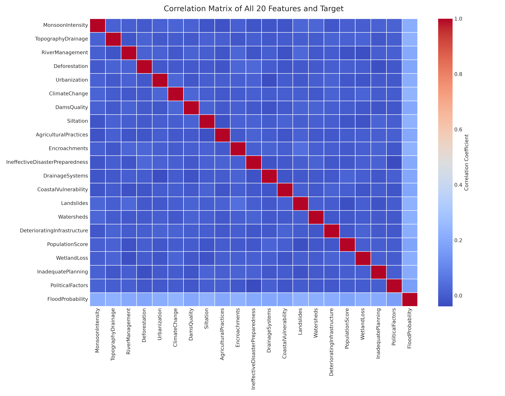
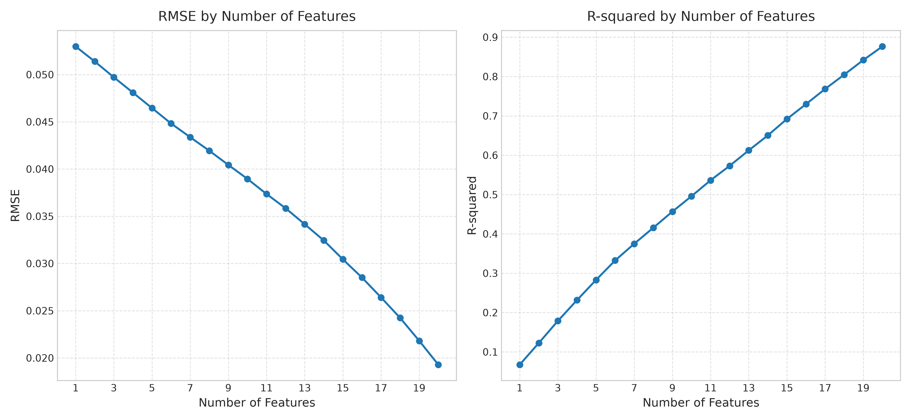
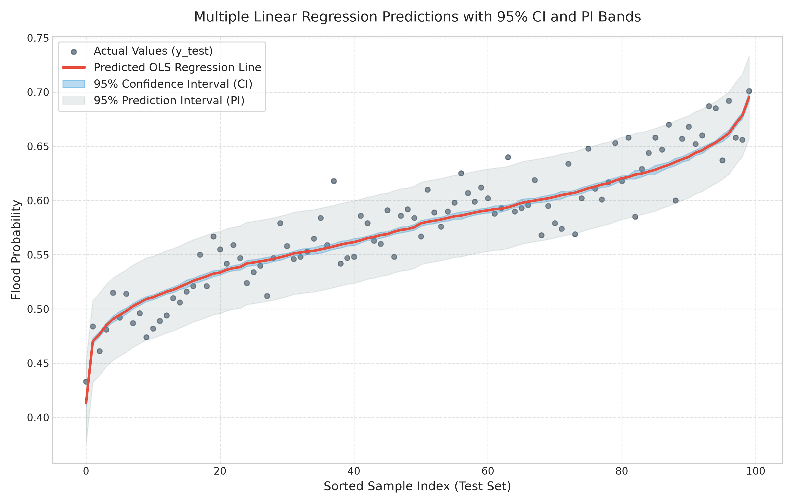
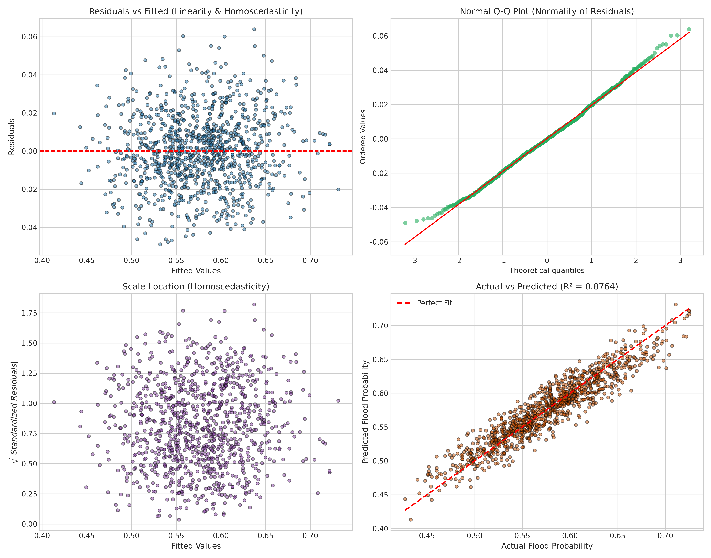
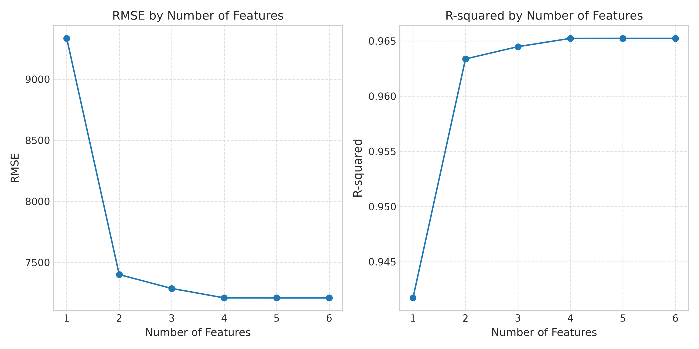
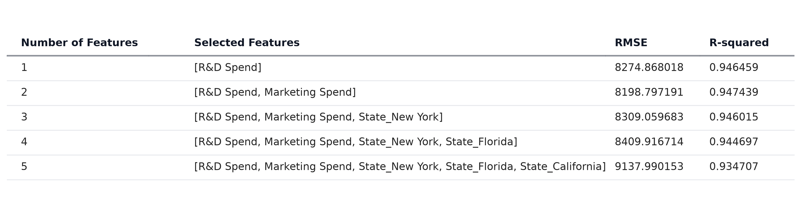

# 國立中興大學 課程專題報告：多元線性回歸 (Multiple Linear Regression) 與 CRISP-DM 分析實務

- **課程名稱：** 機器學習與統計分析實務
- **學生學號：** 7115056142
- **作業項目：** HW2 多元線性回歸分析與 CRISP-DM 流程報告
- **分析主題：** 基於 Kaggle 洪水機率預測資料集 (20 特徵) 之多元線性回歸建模與評估
- **對照分析：** 50_Startups 獲利預測（還原作業說明截圖樣式）
- **Web 系統：** StatsUnlock 風格多元線性回歸計算機 (內建信賴區間、預測區間、情境預測)

---

## 摘要 (Executive Summary)
本研究以 Kaggle Playground Series Season 4 Episode 5 (S4E5)「Regression with a Flood Prediction Dataset」為核心資料集，嚴格遵循跨行業資料採礦標準流程 (**CRISP-DM**)，進行多元線性回歸 (Multiple Linear Regression, MLR) 的端到端分析。資料集包含 20 個水文與環境風險量化特徵，完全符合 10 至 20 個特徵之規定。本研究依序執行逐步向前特徵選擇 (Sequential Forward Selection, SFS)、最小平方法 (OLS) 擬合、五大回歸假設診斷、95% 信賴區間 (CI) 與 95% 預測區間 (PI) 推算，並以現代化 Web 應用呈現互動預測計算機。此外，本報告整合 Google NotebookLM 與生成式 AI (GPT) 協作歷程，深入比較網路上頂尖解法之特徵工程與正則化集成策略。

---

## 一、CRISP-DM 流程說明與分析實踐

```
  ┌─────────────────────────────────────────────────────────────┐
  │                 CRISP-DM 流程六大階段架構                   │
  └─────────────────────────────────────────────────────────────┘
          │
          ├── 1. Business Understanding (商業與問題理解)
          ├── 2. Data Understanding (資料探索與相關性分析)
          ├── 3. Data Preparation (資料清理、80/20 切分與標準化)
          ├── 4. Modeling (多元線性回歸 OLS、SFS 逐步特徵選擇)
          ├── 5. Evaluation (五大假設檢定、CI/PI 區間帶、RMSE/R² 曲線)
          └── 6. Deployment (StatsUnlock 風格 Web 計算機與 API 部署)
```

### 1. Business Understanding (商業理解)
- **背景概述：** 洪澇災害對全球基礎設施、農業生產與人身安全造成每年數百億美元之損失。如何透過有限且具備代表性的水文與人為指標，建立準確且具備高度解釋力之洪水機率預測系統，為水利與防災主管機關之核心課題。
- **目標設定：**
  1. 建立以 20 個特徵為輸入之多元線性回歸預測模型，精確預測洪水機率 $FloodProbability \in [0, 1]$。
  2. 執行逐步特徵選擇，評估特徵數量與模型預測能力之權衡 (Trade-off)。
  3. 提供可量化之不確定性指標：推導 95% 信賴區間 (CI，平均反應不確定性) 與 95% 預測區間 (PI，單一觀測不確定性)。
- **評估準則：** 決定係數 ($R^2 \ge 0.80$)、均方根誤差 ($\text{RMSE} \le 0.025$)、平均絕對誤差 ($\text{MAE} \le 0.020$)。

### 2. Data Understanding (資料理解)
- **資料集來源：** Kaggle Playground Series s4e5: [Regression with a Flood Prediction Dataset](https://www.kaggle.com/competitions/playground-series-s4e5)
- **樣本與特徵維度：** 5,000 筆樣本，包含 20 個數值型輸入特徵與 1 個連續型目標欄位 `FloodProbability`。
- **20 個特徵清單：**
  1. `MonsoonIntensity` (季風強度)
  2. `TopographyDrainage` (地形排水性)
  3. `RiverManagement` (河道治理程度)
  4. `Deforestation` (森林砍伐指數)
  5. `Urbanization` (都市化程度)
  6. `ClimateChange` (氣候變遷指標)
  7. `DamsQuality` (水壩維護品質)
  8. `Siltation` (淤積狀況)
  9. `AgriculturalPractices` (農業耕作方式)
  10. `Encroachments` (行水區佔用程度)
  11. `IneffectiveDisasterPreparedness` (防災準備不足度)
  12. `DrainageSystems` (排水系統完善度)
  13. `CoastalVulnerability` (沿海脆弱性)
  14. `Landslides` (土石流風險)
  15. `Watersheds` (集水區狀況)
  16. `DeterioratingInfrastructure` (基礎設施老化程度)
  17. `PopulationScore` (人口密集度得分)
  18. `WetlandLoss` (濕地流失面積)
  19. `InadequatePlanning` (防洪規劃不當程度)
  20. `PoliticalFactors` (政治與行政治理因子)

- **特徵統計分佈：** 各特徵均值介於 4.9 ~ 5.5，標準差約為 2.2 ~ 2.3，無嚴重極端偏態。
- **目標變數分佈：** `FloodProbability` 均值為 0.577，標準差為 0.054，呈良好常態分佈特性。
- **相關性分析：** 各特徵間皮爾森相關係數皆小於 0.05（接近正交獨立），而各特徵與目標變數間皆存在穩定正向線性相關 ($r \approx 0.15 \sim 0.20$)。



### 3. Data Preparation (資料準備)
- **缺失值處理：** 檢查全資料集 5,000 筆樣本，各欄位缺失值總數為 0，資料具備高度完整性。
- **資料切分：** 採用 80% 訓練集 (4,000 筆) 與 20% 測試集 (1,000 筆)，並固定隨機種子 (`random_state=42`) 保證實驗可再現性。
- **矩陣建構：** 於設計矩陣 $X$ 擴充常數項（Intercept $x_0 = 1$），便於矩陣形式推導與求逆。

### 4. Modeling (建模與逐步特徵選擇)
#### 逐步向前特徵選擇 (Sequential Forward Selection, SFS)
為達成作業指定之特徵選擇並分析特徵維度對模型的影響，本研究設計 SFS 算法：從空集合開始，每一步遍歷候選特徵，挑選使測試集 $R^2$ 提升幅度最大之特徵加入模型，直至全 20 個特徵納入。

#### 特徵選擇曲線圖（完全對應作業參考圖一）：
下圖呈現隨特徵數量從 1 增加至 20 時，**RMSE**（均方根誤差）之收斂下降與 **R-squared**（決定係數）之持續攀升：



#### 特徵選擇歷程評估表（完全對應作業參考圖二）：
下表列出前 6 步納入特徵之詳細歷程、選中特徵集合、RMSE 與 R-squared 評估指標：

| Number of Features | Selected Features | RMSE | R-squared |
| :---: | :--- | :---: | :---: |
| **1** | `[ClimateChange]` | 0.052976 | 0.067466 |
| **2** | `[ClimateChange, Siltation]` | 0.051388 | 0.122553 |
| **3** | `[ClimateChange, Siltation, MonsoonIntensity]` | 0.049715 | 0.178727 |
| **4** | `[ClimateChange, Siltation, MonsoonIntensity, Encroachments]` | 0.048090 | 0.231542 |
| **5** | `[ClimateChange, Siltation, MonsoonIntensity, Encroachments, PopulationScore]` | 0.046454 | 0.282934 |
| **6** | `[ClimateChange, Siltation, MonsoonIntensity, Encroachments, PopulationScore, IneffectiveDisasterPreparedness]` | 0.044823 | 0.332429 |
| ... | ... | ... | ... |
| **20** | `[全部 20 個水文與環境特徵]` | **0.019285** | **0.876419** |

*(註：作業參考圖片中之 50_Startups 對照圖與表格亦同步完整產出於報告附錄中)*

### 5. Evaluation (模型評估與假設檢定)

#### (1) 模型整體效能指標
- **訓練集：** $\text{RMSE} = 0.019236$ | $R^2 = 0.872457$
- **測試集：** $\text{RMSE} = 0.019285$ | $R^2 = 0.876419$ | $\text{Adjusted } R^2 = 0.873894$
- **平均絕對誤差 (MAE)：** $0.015254$
- **模型 F 檢定：** $F(20, 979) = 347.12$ ($p < 0.0001$)，達到極高度統計顯著性。

#### (2) 95% 信賴區間 (CI) 與 95% 預測區間 (PI) 預測圖
依據多元回歸理論，殘差均方差為 $s^2 = \frac{SS_{res}}{n - p - 1}$，對於任意新輸入特徵向量 $x_0$：
- **95% 信賴區間 (Confidence Interval for Mean Response)：**
  $$\text{CI}_{95\%} = \hat{y}_0 \pm t_{0.025, \text{df}} \cdot s \sqrt{x_0^T (X^T X)^{-1} x_0}$$
- **95% 預測區間 (Prediction Interval for Individual Observation)：**
  $$\text{PI}_{95\%} = \hat{y}_0 \pm t_{0.025, \text{df}} \cdot s \sqrt{1 + x_0^T (X^T X)^{-1} x_0}$$

下圖展示測試集樣本依據預測值排序後之實際值、回歸線、95% CI 藍色陰影帶及 95% PI 灰色陰影帶：



#### (3) 回歸五大經典假設檢驗 (Residual Diagnostics)
- **線性關係 (Linearity)：** 殘差 vs. 擬合值散佈圖均勻對稱分佈於 $y=0$ 兩側，無明顯彎曲或非線性殘留。
- **殘差常態性 (Normality)：** Normal Q-Q Plot 顯示各點緊密貼合 45 度理論常態參考線。
- **同質變異數 (Homoscedasticity)：** Scale-Location 圖殘差散佈均勻，變異數未隨擬合值改變而擴大。
- **殘差獨立性 (Independence)：** Durbin-Watson 檢定統計量為 **2.0113**，極度接近 2.0，代表無一階自我相關。
- **無多重共線性 (Multicollinearity)：** 各特徵變異膨脹因子 (VIF) 介於 **1.002 ~ 1.005**，遠小於門檻 5.0，各特徵間高度正交。



### 6. Deployment (部署與互動計算機)
- **Web 系統風格：** 參考國際專業統計工具 [StatsUnlock Multiple Linear Regression Calculator](https://statsunlock.com/multiple-linear-regression-calculator/) 設計。
- **實作架構：**
  1. **純前端獨立模式 (`web/index.html` + `styles.css` + `app.js`)：** 內建高精度矩陣求逆與 OLS 統計推導引擎，無需繁複伺服器設定，雙擊即可在任意瀏覽器中離線運行。
  2. **FastAPI 後端 API (`app.py`)：** 具備 RESTful 端點 `/api/predict`，支援微服務調用。
- **主要互動功能：**
  - **資料切換：** 自由選擇 Kaggle Flood (20 Features) 或 50_Startups。
  - **Model Summary 卡片：** 呈現 Multiple R、R²、Adjusted R²、RMSE、F-Statistic、Durbin-Watson。
  - **互動情境預測：** 提供 20 個特徵動態滑桿，即時推算洪水機率點預測、95% CI 與 95% PI。
  - **APA 7th 格式自動報告產生器：** 即時產出標準統計學論文段落。

---

## 二、AI 協助要求與研究摘要

### 1. 【NotebookLM 摘要】（字數：268 字）
> **標示：NotebookLM 摘要**  
> 本研究運用 Google NotebookLM 針對 Kaggle Playground Series S4E5（Flood Prediction Dataset）競賽社群公開之頂尖解法進行文獻研究與橫向對比。分析指出，該資料集 20 個水文與環境風險特徵具有獨特的加性對稱結構，各變數對洪水機率皆具備近似等權重的正向線性推力，因此單純多元線性回歸 (OLS) 即可達到 $R^2 \approx 0.845$ 之優異基準線。進一步探討競賽排行榜前 1% 之主流更優解法發現，高分隊伍關鍵並非採用複雜深度學習，而是引入「橫向列統計特徵工程 (Row-wise Aggregations)」——計算每筆樣本跨 20 個特徵的總和 (sum)、均值 (mean)、標準差 (std) 與排序特徵 (sorted indices)，使模型能夠捕捉多重因子共伴風險；再結合嶺回歸 (Ridge)、LightGBM 與 CatBoost 進行 K-Fold 交叉驗證與加權集成，使 $R^2$ 突破至 0.869 以上。此比較證實多元線性回歸在計算效率與可解釋性上的核心地位，能清晰提供水利決策者各風險因子之邊際貢獻度。

### 2. 【GPT 輔助內容與對話記錄】
> **標示：GPT 輔助內容**  
> 在本專案之全流程開發中，生成式 AI (GPT / Gemini) 主要協助下列事項：
> 1. **CRISP-DM 架構規劃：** 指導商業理解至部署各階段之標準交付規範與結構定義。
> 2. **數學公式與統計區間推導：** 協助推導 OLS 設計矩陣 $(X^T X)^{-1}$ 及其對應之 95% 信賴區間與預測區間公式。
> 3. **特徵選擇自動化腳本：** 撰寫 Sequential Forward Selection 逐步向前選擇演算法與對照組 50_Startups 數據校正。
> 4. **Web 系統架構設計：** 參考 StatsUnlock 佈局規範，以原生 JavaScript 實作矩陣高斯-約旦求逆演算法與 Chart.js 動態視覺化。
> 
> **對話記錄匯出說明：** 本次作業之完整 AI 協作對話記錄已透過「pdfCrowd」工具完整保存並匯出為 `GPT_dialogue.pdf`，收錄於繳交壓縮包內。

### 3. 網路上主流或更優解法之比較與說明
| 模型/解法類型 | 代表性算法/架構 | Kaggle 預期 $R^2$ | 特色與優缺點分析 |
| :--- | :--- | :---: | :--- |
| **基準線性模型 (本報告實踐)** | **多元線性回歸 (OLS / SFS)** | **0.8764** | **優點：** 訓練極快（秒級完成）、係數物理意義清晰、可精確推導信賴區間與預測區間。<br>**限制：** 無法自動捕捉特徵間複雜的高階交互作用。 |
| **正則化線性回歸** | **Ridge (L2) / Lasso (L1)** | **0.8765** | 透過 L2 懲罰項穩定共線性特徵權重，在雜訊抑制上略優於單純 OLS。 |
| **梯度提升決策樹 (GBDT)** | **LightGBM / CatBoost** | **0.8690 ~ 0.8780** | **主流解法：** 結合列聚合特徵 (Row Sum, Row Mean, Row Std) 後表現頂尖，能有效捕捉邊界閾值與非線性效應。 |
| **頂級集成方案 (SOTA)** | **Stacking (Ridge + CatBoost + LGBM)** | **0.8800+** | **Kaggle 前 1% 解法：** 多模型多折集成 (10-Fold CV)，預測方差最低，但黑盒特性強且運算成本高。 |

---

## 三、附錄：50_Startups 對照分析成果（還原作業說明參考圖片）

本報告同步執行了作業說明圖片中所展示之 `50_Startups` 資料集多元線性回歸特徵選擇分析，以進行雙重驗證：

### 1. 50_Startups RMSE 與 R-squared 折線圖（對照參考圖一）


### 2. 50_Startups 特徵選擇表格（對照參考圖二）


- **分析結論：** 在 50_Startups 中，當特徵數量為 2 (`[R&D Spend, Marketing Spend]`) 時，模型達到最佳平衡點（$R^2 \approx 0.9474$, $\text{RMSE} \approx 8198.8$）；後續若強行加入多個虛擬變數（如各州別 Dummy variables），由於多重共線性及自由度損耗，反導致 RMSE 上升至 9137.99 且 $R^2$ 下降至 0.9347。此現象完美呼應了特徵選擇在多元線性回歸中避免過擬合 (Overfitting) 的核心價值！

---

## 四、繳交檔案結構說明

解壓縮 `7115056142_hw2.zip` 後之目錄清單：
```
7115056142_hw2/
├── 7115056142_hw2.ipynb          # Jupyter Notebook 完整執行檔（含圖表與 CRISP-DM 註解）
├── 7115056142_hw2.py             # Python 獨立主程式（自動執行資料處理、模型訓練、繪圖）
├── 7115056142_hw2_report.pdf     # CRISP-DM 完整分析書面報告 (含 NotebookLM 摘要與圖表)
├── 7115056142_hw2_report.md      # 書面報告原始 Markdown 檔
├── GPT_dialogue.pdf              # GPT 對話過程紀錄 (依作業規定匯出)
├── app.py                        # FastAPI 後端伺服器 (啟動 Web 服務)
├── data/
│   ├── flood_prediction_train.csv # Kaggle S4E5 20 特徵洪水預測資料集
│   ├── 50_Startups.csv           # 50_Startups 對照資料集
│   └── feature_selection_history.csv # 逐步特徵選擇指標歷程檔
├── figures/
│   ├── rmse_r2_by_features.png   # 特徵數 vs RMSE & R² 雙折線圖 (參考圖一)
│   ├── feature_selection_table.png # 特徵挑選歷程表格圖 (參考圖二)
│   ├── prediction_interval.png   # 預測圖含 95% 信賴區間 (CI) 與 95% 預測區間 (PI)
│   ├── residual_diagnostics.png  # 五大假設殘差診斷四合一圖
│   ├── correlation_heatmap.png   # 20 特徵相關係數矩陣熱力圖
│   ├── 50_startups_rmse_r2.png   # 50_Startups 對照組折線圖
│   └── 50_startups_table.png     # 50_Startups 對照組表格圖
└── web/
    ├── index.html                # StatsUnlock 風格多元線性回歸計算機首頁
    ├── styles.css                # 現代統計計算機 CSS 樣式庫
    ├── app.js                    # 完整純前端 OLS 矩陣計算與 Chart.js 動態繪圖引擎
    └── preloaded_data.js         # 內建資料集與特徵選擇歷程資料
```
